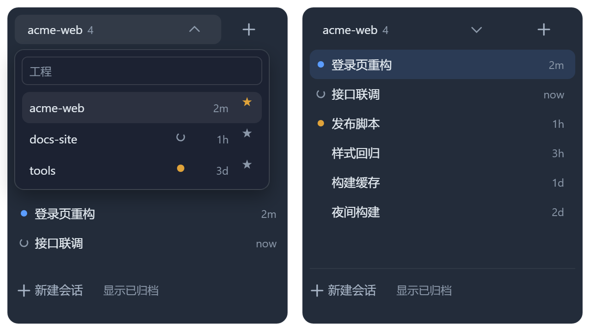

# dsh-project-scope

把 [DeepSeek Harness](https://github.com/deepseek-ai) 的左侧边栏从「所有工程的会话堆在一起」改成「**一次只看一个工程**」：顶上是一个工程切换器，下面只列当前工程的会话。

- 仓库：<https://github.com/voidobserve/dsh-project-scope>
- npm：尚未发布



## 功能

| 位置 | 行为 |
| --- | --- |
| 顶部切换器 | 显示当前工程名和未归档会话数；点开列出全部工程，可输入过滤（匹配名称或路径），每行带状态点、相对时间和收藏星标 |
| 切换工程 | 直接打开该工程最近一条非空会话；一条会话都没有就切到该工程，停在空白新会话上 |
| 会话列表 | 只列当前工程的会话：固定的在最前（按固定顺序），其余按最近活动倒序；已归档的排到末尾且默认隐藏 |
| 状态 | 运行中显示转圈；等待批准 / 计划待审 / 等待回答黄点；已完成未查看蓝点 |
| 行操作 | 悬停第一颗按钮固定 / 取消固定；`...` 菜单里重命名（回车保存、Esc 取消）、分叉会话、复制会话 ID、归档（隐藏） |
| 底部 | 「新建会话」；「显示已归档」开关，打开后归档行右侧出现取消归档按钮 |
| 跟随 | 从侧边栏之外打开的会话（资源管理器右键、分叉、快捷键）会把侧边栏切到它所属的工程，列表不会停在用户已经离开的工程上 |

工程顺序是「默认工作区 → 收藏（按收藏时间）→ 其余按最近活动」。当前停在哪个工程记在 `localStorage`，刷新页面还在；关掉正在看的会话也不会跳走。

## 工程按根目录归并

一个「工程」不是注册路径本身，而是**根目录**：

1. 如果某个已注册工作区的路径是另一个已注册工作区的上级目录，两者合并成一个工程（根目录取最上层那个）；
2. 否则，如果路径里带 `code` 段（例如 `<工程>\code\<工程>-xxx`），取 `code` 之上那层作为根目录。

所以 `<工程>` 与 `<工程>\code\project-xxx` 在切换器里只出现一次，它们的会话合并在同一个列表里。

## 状态

当前 **0.1.x**：功能可用，但接口（占用的 slot `sidebar.workspaces`、读的 Client 服务、`localStorage` 键名）和安装方式都可能变，破坏性改动不保证向后兼容。

## 兼容性

| dsh 版本 | 状态 |
| --- | --- |
| 0.2.2-rc.5 | 实测通过（当前安装版本）：占用 `sidebar.workspaces`、会话 / 工作区快照、`uiWorkspace` 的打开 / 固定 / 归档 / 分叉 |

插件没有声明 `engines.dsh`，所以版本不匹配时不会被安装门禁拦住，也就不会提前告诉你接口已经变了。它靠的是 slot 的回退：占不到 `sidebar.workspaces` 时只会在控制台报一句 `could not occupy sidebar.workspaces`，内置侧边栏照常显示。升级 dsh 后如果侧边栏变回内置样式，先看这条日志。

## 安装

### 从本地目录 / GitHub 安装

```powershell
# 仓库本身就是插件包（package.json 在根目录）
dsh plugin --profile desktop add C:\path\to\dsh-project-scope

# 仓库发布之后也可以直接按仓库装
dsh plugin --profile desktop add github:voidobserve/dsh-project-scope
```

`dsh plugin` 只是把参数转发给 profile 目录里的 pnpm，它会往 `dependencies` 写一条，但**不会**改 `dsh.profile.bundles`。要把插件挂上启动列表，还得在同一个 `package.json` 的 `dsh.profile.bundles` 数组里加一项 `"dsh-project-scope"`（用界面安装时会自动写这两处）。

用 `link:` 挂本地目录时，当前 dsh 进程会继续用它内存里的旧模块；改了 `client.js` 刷新页面即可（Ctrl+R），改了 `package.json` 或 `cordis.patch.yml` 要重启 dsh。

### 停用 / 卸载

在「插件」里停用即可**立刻恢复内置侧边栏**（工作区树、拖拽排序、会话全文搜索、悬浮卡片都回来），会话和工作区数据不受影响。

## 工作原理

- 整个面板在 `client.js`（页面侧）：注册到 `sidebar.workspaces` 这个 root-scoped `single` slot，`priority: -1`，顶掉内置的工作区浏览器。内置浏览器是同一个 slot 的另一个 registrant，所以停用插件就自动回退到它。宿主侧 `index.js` 只有一个空的 `apply()`，存在只是为了让 bundle 能被解析。
- 数据来自 Client 服务的 `sessions` / `workspaces`，它们的 `list` 是快照 store（`getSnapshot()` + `subscribe(fn)`）。
- 操作走 `uiWorkspace.openSession / openWorkspace / pinSession / unpinSession / archiveSession / unarchiveSession / forkSession`；重命名走 `sessions.using(id, ...).binding.session.rename(title)`。
- 状态依赖可选的 `useSessionStatus`：拿不到时就退化成没有状态点的列表，而不是整块报错。
- 本地状态：`dsh-project-scope:selected-workspace`、`dsh-project-scope:favorites`。

```
index.js              宿主侧占位行
client.js             侧边栏面板（React + 原生事件，无构建步骤）
cordis.patch.yml      insert 一条 project-scope 行
locale/{en,zh}.json   插件列表里的标题 / 描述 / 详情
docs/DETAIL.md        功能与限制说明（插件详情页展示）
docs/demo.png         README 里的示意图
icon.svg              插件图标
test/render-smoke.mjs 离线渲染 smoke
```

## 开发

```bash
node test/render-smoke.mjs
```

用 React stub + 假的 `sessions` / `workspaces` 服务把面板渲染一遍，每个场景打一条 PASS。覆盖：正常有会话、会话数据缺失、跟随打开的会话、归档后仍留在原工程、默认工作区排最前、没有任何工作区、缺可选 section scroller、缺可选状态 hook。

没有构建步骤：`client.js` 就是浏览器直接执行的文件，改完刷新页面即可；语法用 `node --check client.js` 也能过。

## 已知限制

- 接管期间，内置的工程浏览器（工作区树、拖拽排序、会话全文搜索框、悬浮卡片）由本插件替代；停用即恢复。
- 归档是隐藏，不删除；取消归档要先打开底部「显示已归档」。
- 工程归并按已注册工作区的路径推断，不做磁盘扫描；注册路径之外的目录不会被发现。
- 只有中英文两套文案。
- 只在 Web（桌面）界面验证过。

## License

MIT
